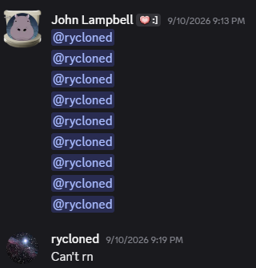
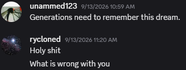
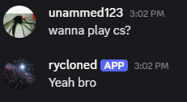
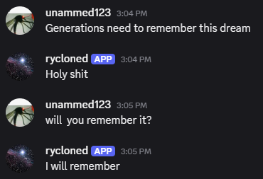
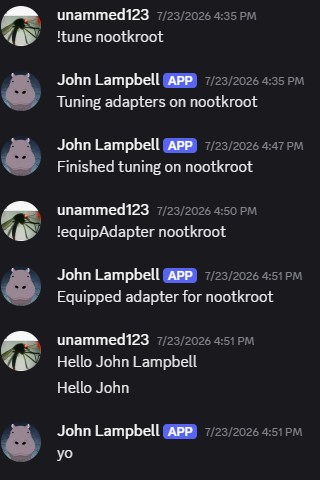
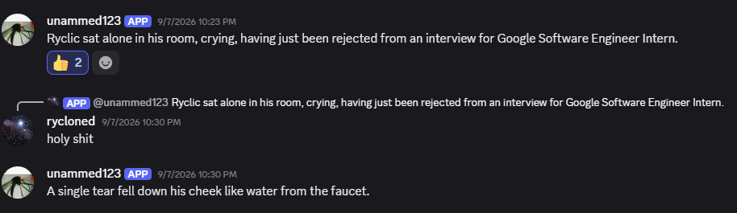
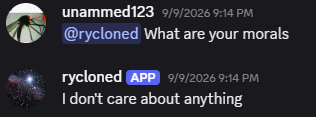
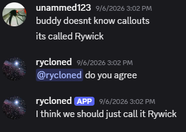

## Ryclank

Are your friends too busy to play games with you? Are they always unavailable?
<body align="left">
  
</body>

Are they unsupportive of you and your goals?
<body align="left">
  
</body>

Well fear not. You can replace them with AI! You can have a perfect friend that acts <b>Exactly</b> like your replaced friend!

<body align="left">
  
</body>

<body align="left">
  
</body>

### You can:
Tune the bot on anyone. It will read all of the user's conversations, and build replies based on how the user responds to different scenarios.
<body align="left">
  
</body>

Tell heart wrenching stories by directing the bot.
<body align="left">
  
</body>

Directly message the bot in non-activated channels by pinging it. It will read the recent conversation history and make a response.
<body align="left">
  
</body>

<body align="left">
  
</body>